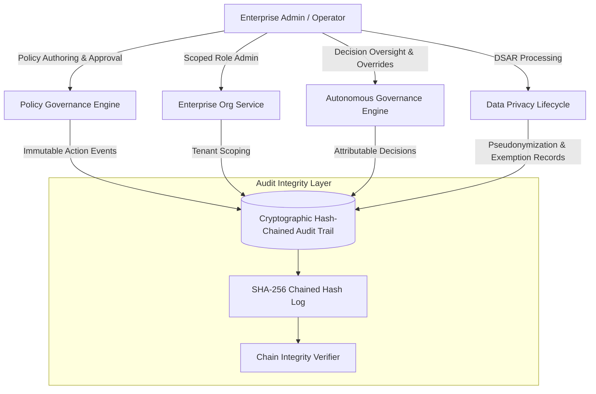

# Phase 20 Architecture: Autonomous Marketplace Governance, Compliance & Enterprise Readiness

## 1. System Overview
Phase 20 elevates EcivreS to enterprise readiness by introducing centralized policy lifecycle management, cryptographic tamper-evident administrative audit logging, enterprise multi-tenancy with scoped role delegation, comprehensive data subject access and lifecycle workflows (DSAR), and authoritative operator oversight for autonomous decisions.

## 2. Core Pillars

### 2.1 Centralized Marketplace Policy Governance
- **Lifecycle States**: `DRAFT` $\rightarrow$ `REVIEW` $\rightarrow$ `APPROVED` $\rightarrow$ `ACTIVE` $\rightarrow$ `RETIRED`.
- **Separation of Duty (SoD)**: The author of a policy cannot approve their own policy (`authorId !== approverId`).
- **Controlled Activation & Instant Rollback**: Activating an approved policy retires active instances in the same category and tenant. Rollbacks reactivate a designated previously-approved version and retire the target with reason attribution.

### 2.2 Tamper-Evident Immutable-Style Audit Trail
- **Cryptographic Hash Chaining**: Every administrative audit event is linked to the previous event via SHA-256:
  $$\text{entryHash} = \text{SHA256}(\text{previousHash} + \text{actorId} + \text{action} + \text{targetResource} + \text{targetId} + \text{timestamp} + \text{metadata})$$
- **Sensitive Data Redaction**: Automatic redaction of sensitive credentials (passwords, tokens, API keys, CVVs, credit cards) before hashing or database persistence.
- **Continuous Integrity Verification**: Linear verification traverses the log from genesis hash to head; any record payload or hash alteration is instantly detected.

### 2.3 Enterprise Organization Tenancy
- **Tenant Scoping**: Dedicated `EnterpriseOrganization` records with unique slugs and enterprise tiers (`ENTERPRISE`, `BUSINESS`, `PRO`).
- **Scoped Roles & Delegation**: Roles include `OWNER`, `ADMIN`, `BILLING`, and `MEMBER`.
- **Cross-Tenant Isolation**: Server-enforced membership validation rejects any cross-tenant data access attempts with HTTP 403 `ForbiddenException`.

### 2.4 Data Privacy & Lifecycle Controls (DSAR)
- **Data Portability**: Structured user data export bundles encompassing profile, booking transactions, payment ledgers, and reviews.
- **Account Deletion & Statutory Exemption**: Hard deletion is safely avoided for accounting and tax compliance; personal identifiers are pseudonymized while financial and invoice records are preserved under a 7-year statutory financial retention exemption.

### 2.5 Autonomous Decision Governance & Operator Oversight
- **Human-in-the-Loop Oversight**: Operators can review pending autonomous decisions, grant approvals, execute overrides with custom parameters, or reject proposals with full attribution.
