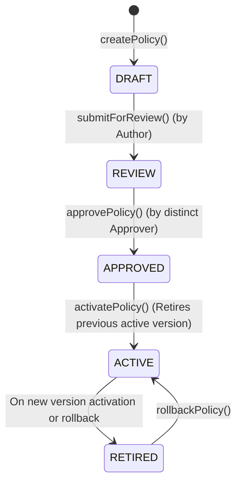

# Centralized Policy Governance & Versioned Lifecycle

## 1. Overview
The Policy Governance Engine coordinates versioned business rules, pricing caps, supply thresholds, and trust guardrails across the marketplace.

## 2. Policy Lifecycle State Machine



## 3. Separation of Duty (SoD)
To prevent rogue policy authoring and unilateral rule modifications, the author of a policy cannot approve their own submission:
```typescript
if (policy.authorId === dto.approverId) {
  this.logger.error(`Separation of duty violation: Author '${dto.approverId}' attempted to approve own policy.`);
  throw new ForbiddenException(`Separation of duty violation: Policy author cannot approve their own policy.`);
}
```

## 4. Versioned Rollback
When an active policy produces undesirable marketplace dynamics:
1. An authorized operator calls `POST /api/v1/governance/policies/rollback`.
2. The current active policy is marked `RETIRED` with `rollbackVersion` recorded.
3. The designated prior version is re-promoted to `ACTIVE`.
4. An immutable audit record is appended with operator ID and business justification.
