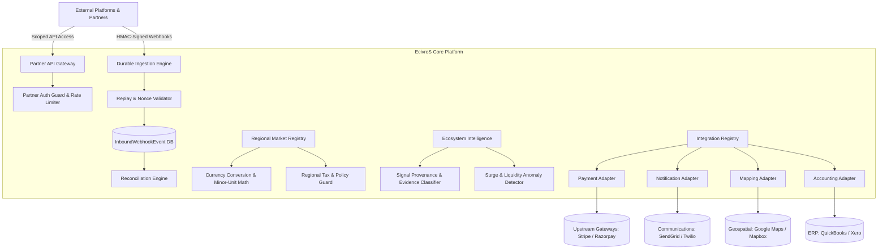

# Phase 21 Architecture: Autonomous Marketplace Ecosystem, Interoperability & Global Expansion

## 1. System Overview
Phase 21 expands EcivreS into a global interoperable marketplace ecosystem. It connects external providers (payment gateways, communications, geocoding/routing, enterprise ERP), ingestion of durable HMAC-authenticated webhooks, multi-region configuration with integer minor-unit currency math, market intelligence signal provenance, and scoped partner developer APIs.

## 2. Core Architectural Pillars

### 2.1 Pluggable Integration Framework
- Base adapter abstraction (`BaseIntegrationAdapter`) with built-in latency telemetry, circuit-breaker hooks, and timeout enforcement.
- Concrete adapters for payments, communications, geospatial routing, and enterprise ERP sync.

### 2.2 Durable, Idempotent Webhook Processing
- HMAC-SHA256 signature verification with constant-time comparison and 5-minute clock skew guardrails.
- Idempotency layer with in-flight concurrency locking and 24-hour cache deduplication.
- State-machine lifecycle (`PENDING` $\rightarrow$ `PROCESSING` $\rightarrow$ `PROCESSED` / `FAILED` $\rightarrow$ `DEAD_LETTER`).
- Jittered exponential backoff retries and automated reconciliation against authoritative upstream state.

### 2.3 Regional Readiness & Minor-Unit Currency Mathematics
- Minor-unit integer arithmetic avoiding IEEE 754 floating-point inaccuracies.
- Proportional cent distribution without loss of remainders.
- Real-time exchange rate caching with fallback to treasury parity.
- Regional statutory taxation (US Sales Tax, Indian GST, European VAT) and local consumer cancellation statutes.

### 2.4 Decision Provenance & Evidence Quality
- Epistemic taxonomy: `FACT`, `STATISTICAL_ESTIMATE`, `PREDICTION`, `RECOMMENDATION`, `EXECUTED_ACTION`.
- Sample size and freshness thresholds preventing autonomous action on sparse or stale data.
- Diagnostic sanitization preventing model prompt/weight leakage.

### 2.5 Scoped Partner APIs & Developer Ecosystem
- Cryptographically hashed (`SHA-256`) API keys with single-exposure plaintext provisioning.
- Tenant-scoped role authorization and strict cross-tenant isolation.
- Sliding-window rate limiting (requests/minute) returning RFC-standard HTTP 429.
- Outbound event webhook subscriptions with HMAC signatures.
