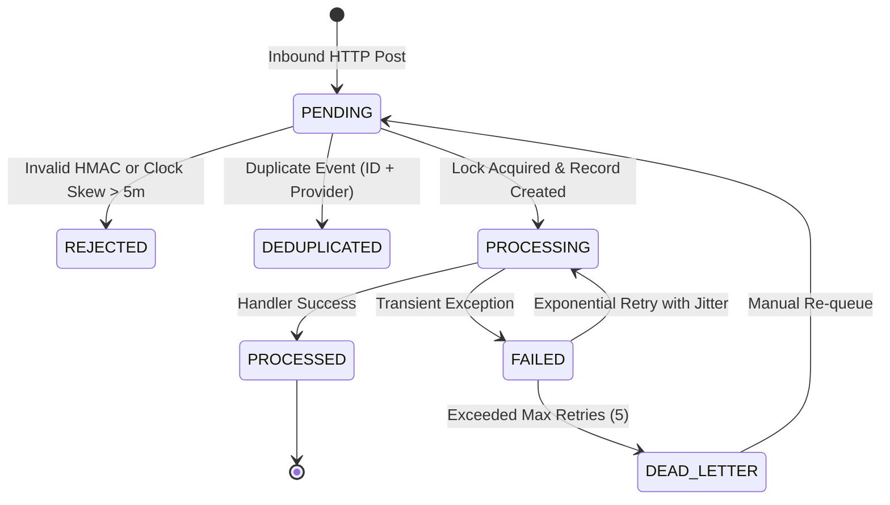

# Durable Webhook Ingestion & Reliability Engine

## 1. Overview
External providers push real-time event updates (e.g., payment captures, chargebacks, delivery confirmations) via inbound webhooks. The Webhook Reliability Engine ensures that every external event is authenticated, deduplicated, processed idempotently, retried with exponential backoff and jitter, and reconciled against upstream truth.

## 2. Ingestion Lifecycle State Machine

## 3. Cryptographic Verification & Replay Protection
1. **HMAC-SHA256**: Signatures are evaluated using constant-time `timingSafeEqual()` comparisons to thwart timing attacks.
2. **Clock Skew Guardrail**: Timestamps drifting $> 300\text{s}$ (5 minutes) from server time are rejected with HTTP 401.
3. **Idempotency Locking**: In-flight concurrency locks reject parallel duplicate webhooks with HTTP 409 `ConflictException`.
4. **Authoritative Reconciliation**: `WebhookReconciliationService` periodically polls unacknowledged events and synchronizes them against authoritative provider APIs.
