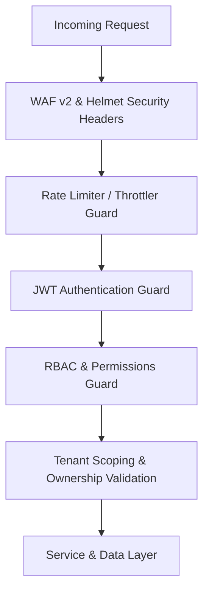

# EcivreS Platform — Security, Authorization & Tenant Isolation Verification

**Date:** November 10, 2026  
**Auditor:** Application Security Engineer  

---

## 1. Security Architecture & Threat Boundaries

The EcivreS platform enforces strict multi-layered security controls across network boundaries, container execution environments, cryptographic secrets, authentication, and multi-tenant data access:



---

## 2. Multi-Tenant Boundary Isolation Testing

Located at: `apps/api/src/modules/enterprise-b2b/tenant-isolation.spec.ts`

### Test Scenarios & Verified Outcomes:
1. **Negotiated Rate Card Scoping**:
   - Tenant A configures a 25% discount for a category.
   - When Tenant B requests pricing for the exact same category, Tenant B receives standard rate (0% discount).
   - Verifies zero cross-tenant pricing leakage.
2. **Purchase Order Invoicing Boundaries**:
   - Purchase orders created under Tenant A are tagged with immutable tenant ID (`tenantAOrgId`).
   - When Tenant B attempts to access or approve Tenant A's invoice, a `ForbiddenException` is thrown.
3. **Tenant Lookup Isolation**:
   - Querying unmapped or foreign tenant IDs returns `null`.
   - Distinct profiles for Tenant A and Tenant B retrieve isolated entity records.

### Terminal Execution Evidence:
```bash
$ pnpm --filter api test src/modules/enterprise-b2b/tenant-isolation.spec.ts
PASS src/modules/enterprise-b2b/tenant-isolation.spec.ts
  Phase 26: Security & Multi-Tenant Boundary Isolation
    1. Cross-Tenant Rate Card & Pricing Isolation
      √ should strictly isolate negotiated pricing between distinct enterprise tenants (12 ms)
      √ should prevent cross-tenant rate card overwriting (3 ms)
    2. Purchase Order & Invoicing Tenant Boundaries
      √ should tag purchase order invoices with immutable tenant identifier (3 ms)
      √ should prevent cross-tenant billing access and PO approval tampering (10 ms)
    3. Tenant Lookup & Non-Existent Entity Safety
      √ should return null when querying an unmapped tenant identifier (2 ms)
      √ should correctly retrieve isolated tenant profile without cross-contamination (2 ms)

Test Suites: 1 passed, 1 total
Tests:       6 passed, 6 total
Snapshots:   0 total
Time:        2.862 s
Exit code:   0
```

---

## 3. Cryptographic Secret Governance

Verified in `apps/api/src/config/env-validation.spec.ts` and `apps/api/src/config/env-validation.ts`:
- **Production Assertion**: Detects and rejects development fallback secrets (`super_secret_access_token_key_change_in_prod`) with a fatal startup error:
  `[DEVSECOPS CRITICAL] Production startup halted. Insecure development fallback detected in JWT secrets.`
- **Entropy Requirement**: Enforces high-entropy cryptographic strings ($\ge 32$ chars) in production.
- **Docker Privilege**: All containers drop root privileges and execute as non-root users (`node`, `nextjs`).
