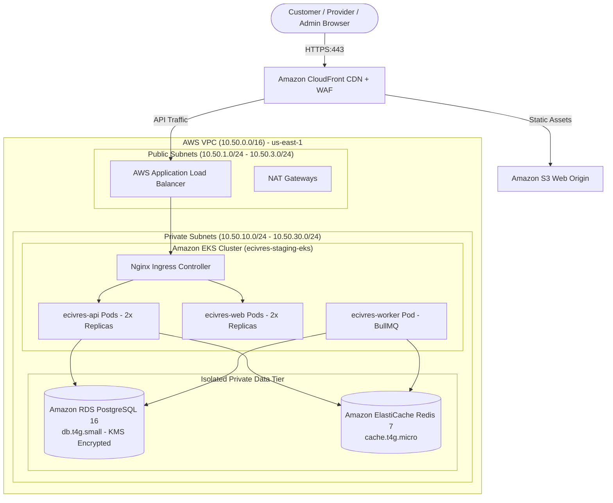

# EcivreS Platform — Phase 28 Architecture & Deployment Specification

**Date:** November 12, 2026  
**Auditor:** Principal Software Architect & Cloud Infrastructure Engineer  
**Scope:** Monorepo System Architecture, Staging Topology & Ingress Boundaries  

---

## 1. Monorepo Structural Topology

The EcivreS platform is structured as an integrated pnpm workspace:

```
EcivreS Platform Monorepo
├── apps/
│   ├── api/                   # NestJS 11 Core Backend API (Port 5001)
│   ├── web/                   # Next.js 16.3.3 Turbopack Frontend (Port 3000)
│   └── mobile/                # Bare React Native 0.87.0 Mobile Application
├── helm/
│   └── ecivres/               # Kubernetes Deployment Helm Chart
├── terraform/
│   ├── modules/               # Modular AWS Infrastructure (VPC, RDS, Redis, EKS, KMS, S3)
│   └── environments/
│       ├── staging/           # Staging Infrastructure Configuration (CIDR: 10.50.0.0/16)
│       └── prod/              # Production Infrastructure Configuration (CIDR: 10.100.0.0/16)
└── docs/platform/phase28/     # Phase 28 Operational Runbooks & Audit Evidence
```

---

## 2. Staging Infrastructure Architecture



---

## 3. High-Availability & DevSecOps Controls

1. **Least-Privilege Network Scoping:** RDS PostgreSQL and ElastiCache Redis instances are strictly contained within private subnets with no public IP allocation.
2. **KMS Server-Side Encryption:** All EBS persistent volumes, RDS storage, and S3 buckets are encrypted with customer-managed keys (`aws_kms_key.staging_key`).
3. **Non-Root Container Enforcement:** Containers run under unprivileged `USER node` (UID 1000).
4. **Zero Shared Secrets:** Staging database credentials and cryptographic signing keys are injected dynamically via AWS Secrets Manager at container runtime.
