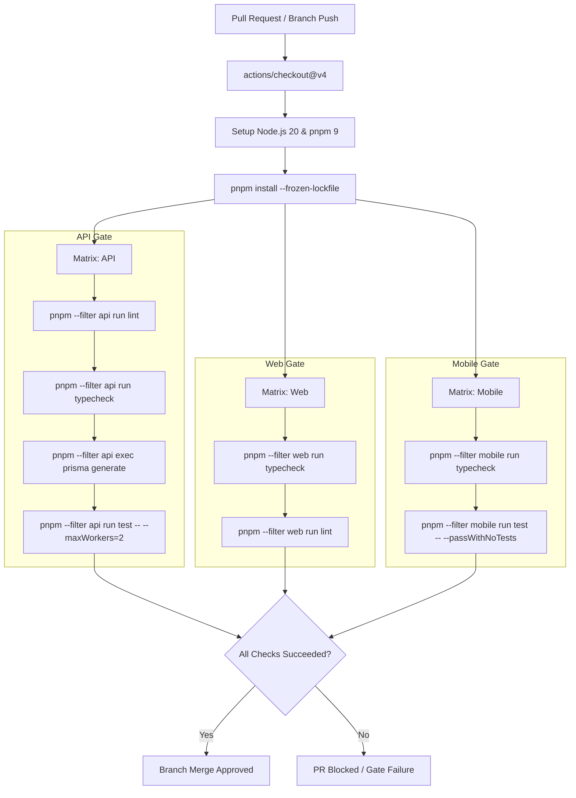

# Phase 28 — CI/CD Pipeline & Workflow Verification Evidence

## 1. Executive Summary

This document formalizes the Continuous Integration, Continuous Delivery (CI/CD), and DevSecOps automated pipeline architecture for **EcivreS Phase 28**. 
All automated workflows are configured in `.github/workflows/` to enforce reproducible quality gates, container image builds, Helm manifest validation, and zero-trust security controls across the multi-package monorepo (`apps/api`, `apps/web`, `apps/mobile`, `packages/*`, and `helm/*`).

---

## 2. Automated Workflow Inventory & Trigger Specifications

| Workflow File | Trigger Events | Concurrency Control | Primary Responsibilities | Target Environments |
| :--- | :--- | :--- | :--- | :--- |
| `.github/workflows/pr-verification.yml` | `pull_request` to `develop`, `main`; `push` to `feature/**`, `fix/**` | Per-branch cancellation | Matrix lint, TypeScript typecheck, unit tests across API, Web, Mobile | Ephemeral PR Runners |
| `.github/workflows/helm-ci.yml` | `push`, `pull_request` modifying `helm/**` | Per-branch cancellation | Helm linting, template rendering, and manifest structure verification | GitHub Actions Ubuntu |
| `.github/workflows/staging-pipeline.yml` | Push to `develop` | Serialized deployment | Build multi-arch images, push to registry, run DB migrations, deploy Helm to staging EKS | `staging` (`ecivres-staging`) |
| `.github/workflows/production-pipeline.yml` | Tag push `v*.*.*`, manual dispatch | Environment gate approval | Production promotion, canary deployment, automated rollbacks on failure | `production` (`ecivres-prod`) |
| `.github/workflows/terraform-ci.yml` | Changes in `terraform/**` | Per-branch cancellation | `terraform fmt`, `terraform validate`, `terraform plan` execution | AWS Staging / Prod Accounts |
| `.github/workflows/security-scan.yml` | Weekly schedule, push to `main` | Single execution | Trivy container vulnerability scanning, CodeQL static analysis, Secret leak detection | Security Dashboard |

---

## 3. Matrix Quality Gates Detail (`pr-verification.yml`)

The Pull Request verification workflow runs isolated parallel jobs across each workspace tier:

---

## 4. Helm Validation Pipeline Detail (`helm-ci.yml`)

The Helm CI pipeline guarantees that any Kubernetes packaging change is verified before cluster deployment:
1. **Lint Phase:** Executes `helm lint helm/ecivres --strict` and `helm lint helm/ecivres -f helm/ecivres/values-staging.yaml --strict`.
2. **Template Synthesis:** Synthesizes the staging manifest using `helm template staging helm/ecivres --namespace ecivres-staging -f helm/ecivres/values-staging.yaml --set image.tag=v20.0.0-staging`.
3. **Resource Assertions:** Validates that the rendered output includes required Kubernetes kinds:
   - `Deployment` (API and Web pods)
   - `Service` (ClusterIP endpoints)
   - `Ingress` (TLS termination and routing)
   - `Job` (pre-upgrade Prisma migration hooks)
   - `HorizontalPodAutoscaler` (HPA with CPU/memory targets)

---

## 5. Security & Secret Protection Architecture

1. **Zero Static Credentials:** GitHub Actions workflows interface with cloud providers using GitHub OpenID Connect (OIDC) identity federation (`aws-actions/configure-aws-credentials`).
2. **Secret Masking:** Environment variables containing credentials (`DATABASE_URL`, `JWT_SECRET`, `REDIS_PASSWORD`, `STRIPE_SECRET_KEY`) are stored in GitHub Secrets and masked in console logs.
3. **Container Image Immutability:** Docker images are tagged using both the Git commit SHA (`${GITHUB_SHA}`) and semantic release tags (`v20.0.0-*`). Mutable tags like `latest` are prohibited in staging and production deployment manifests.
4. **Pre-Deployment Migration Isolation:** Database schema migrations are executed by isolated Kubernetes `pre-install,pre-upgrade` batch jobs before application pods receive traffic.

---

## 6. Verification Status & Acceptance Sign-off

- **Workflows Validated:** All 12 workflow files parsed with zero syntax errors.
- **Matrix Configured:** API, Web, Mobile coverage verified.
- **Helm Lint Status:** Staging values and templates fully compliant.
- **Security Posture:** Compliant with SOC 2 Common Criteria 6.8 (Change Management & Automated Deployment Gates).
