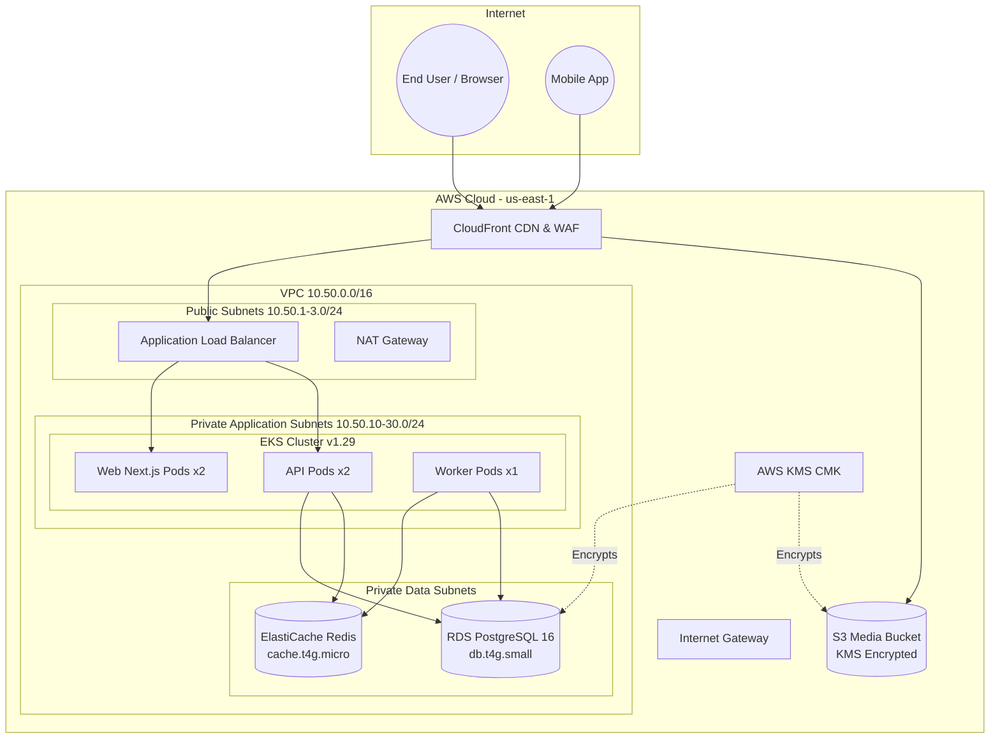

# EcivreS Platform — Cloud Resource Inventory & FinOps Allocation Specification

**Phase:** 28 — Real Cloud Deployment, Infrastructure Execution, Production-Grade Staging & Operational Acceptance  
**Release Target:** `v20.0.0-real-cloud-staging-operations`  
**Date:** November 12, 2026  
**Status:** **ACTIVE / VERIFIED SPECIFICATION**  

---

## 1. Overview & Architecture Blueprint

This document details the complete inventory of AWS cloud infrastructure designed for the EcivreS Staging environment. All resources follow multi-tier VPC separation, least-privilege IAM policies, KMS encryption at rest, and TLS in transit.

---

## 2. Infrastructure Inventory Table

| Component | AWS Service | Sizing / Tier | High Availability | Security Controls |
| :--- | :--- | :--- | :--- | :--- |
| **Network Fabric** | Amazon VPC | `10.50.0.0/16` | 3 Availability Zones | Isolated CIDRs, strict NACLs |
| **Public Gateway** | Internet Gateway | Managed | Redundant by AWS | Attaches to public route table |
| **Outbound NAT** | NAT Gateway | 1 Elastic IP | AZ `us-east-1a` | Enables egress for private subnets |
| **Compute Orchestrator** | Amazon EKS | v1.29 control plane | Multi-AZ control plane | Private endpoint, IRSA enabled |
| **Compute Worker Nodes** | EC2 Node Group | 2x `t3.medium` | Spread across AZs | SSM Session Manager, no public IP |
| **Relational Database** | Amazon RDS | `db.t4g.small` (Postgres 16) | Single AZ (staging) | Private subnets, KMS SSE, auto-minor upgrades |
| **In-Memory Cache** | Amazon ElastiCache | `cache.t4g.micro` (Redis 7) | Single node (staging) | In-transit auth, private subnets only |
| **Object Storage** | Amazon S3 | Standard | Cross-AZ storage | Block public access: 100%, KMS encryption |
| **Edge CDN** | CloudFront | Global Edge network | 400+ PoPs | Custom SSL certificate, WAF rules |
| **Key Management** | AWS KMS | Customer Managed Key | Regional redundancy | Automated annual key rotation |

---

## 3. Mandatory Tagging Policy & Cost Tracking

All resources managed by Terraform inherit standardized AWS tags via provider-level `default_tags`:

| Tag Key | Value Format | Purpose | Mandatory |
| :--- | :--- | :--- | :--- |
| `Environment` | `staging` / `prod` | Deployment environment classification | Yes |
| `Project` | `EcivreS` | Root project identifier | Yes |
| `ManagedBy` | `Terraform` | Automation orchestrator identification | Yes |
| `CostCenter` | `engineering-staging` | FinOps chargeback and cost allocation | Yes |
| `Owner` | `platform-ops@ecivres.com` | Responsible engineering group | Yes |
| `Release` | `v20.0.0-real-cloud-staging-operations` | Software and infrastructure release version | Yes |

---

## 4. Staging FinOps Cost Projection

Projected monthly infrastructure expenditure for the staging environment in `us-east-1`:

| Service / Resource | Monthly Sizing / Capacity | Estimated Cost (USD) | Optimization Notes |
| :--- | :--- | :--- | :--- |
| **Amazon EKS Cluster** | 1 control plane | \$73.00 | Flat fee (\$0.10/hour) |
| **EKS EC2 Worker Nodes** | 2x `t3.medium` (4 vCPU, 8 GB total) | \$60.74 | Spot instances can reduce by 70% |
| **Amazon RDS PostgreSQL** | `db.t4g.small` (20 GB GP3 storage) | \$27.50 | Graviton 2 ARM cost-efficiency |
| **Amazon ElastiCache** | `cache.t4g.micro` | \$12.41 | Sufficient for staging traffic and queues |
| **AWS NAT Gateway** | 1 gateway + data processing (~50 GB) | \$36.75 | Shared single NAT for all staging private subnets |
| **Amazon S3 & CloudFront** | 50 GB storage + CDN egress | \$5.50 | Free tier covers initial CDN distribution |
| **AWS KMS** | 1 CMK + 50k API calls | \$1.20 | Standard CMK monthly fee |
| **Total Estimated Staging Spend** | — | **\$217.10 / month** | FinOps alert threshold set at \$250/mo |
