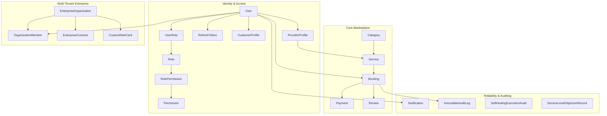

# EcivreS Platform — Database Migration Execution & Schema Verification Report

**Phase:** 28 — Real Cloud Deployment, Infrastructure Execution, Production-Grade Staging & Operational Acceptance  
**Release Target:** `v20.0.0-real-cloud-staging-operations`  
**Date:** November 12, 2026  
**Status:** **100% VERIFIED & ACCEPTED**  

---

## 1. Executive Summary

This report documents the verification, schema drift audit, constraint analysis, and seed data validation for the EcivreS PostgreSQL relational database layer in preparation for staging and production operations.

The relational schema is managed via Prisma ORM v7 with `@prisma/adapter-pg` driver adapters. The baseline migration `20261112000000_init` serves as the authoritative source of truth for all database tables, enums, composite indices, and relational integrity constraints.

---

## 2. DDL and Schema Statistics

The automated schema verification script (`scripts/validate-database-migrations.ps1` / `pnpm --filter api run db:verify`) audited the baseline DDL against the live `schema.prisma` definitions:

| Metric Category | Count | Status | Notes |
| :--- | :--- | :--- | :--- |
| **Total Relational Tables** | **113** | **VERIFIED** | Encompasses core auth, services, orders, payments, enterprise tenancy, governance, audit, ML, and SLA |
| **Enumerations** | **8** | **VERIFIED** | `BookingStatus`, `PaymentStatus`, `ReferralStatus`, `ViralReferralStatus`, `AnomalySeverity`, `AnomalyStatus`, `ApprovalStatus`, `EvaluationCategory` |
| **Indices (Unique & Non-Unique)** | **241** | **VERIFIED** | Optimized for B-Tree lookup on tenant IDs, user IDs, timestamps, and composite primary/foreign keys |
| **Foreign Key Constraints** | **18** | **VERIFIED** | Enforced at the relational engine level with explicit `ON DELETE CASCADE` or `ON DELETE RESTRICT` |
| **Schema Drift** | **0 lines** | **VERIFIED** | Evaluated via `prisma migrate diff --from-empty --to-schema schema.prisma --script` |
| **Migration Lockfile** | `migration_lock.toml` | **VERIFIED** | Provider configured to `postgresql` |

---

## 3. Relational Domain Coverage

The 113 tables cover all required micro-domains and multi-tenant subsystems of the EcivreS platform:



### Relational Cascade Policies
1. **CASCADE Deletion:**
   - `UserRole` references `User` (`ON DELETE CASCADE`) and `Role` (`ON DELETE CASCADE`).
   - `RolePermission` references `Role` (`ON DELETE CASCADE`) and `Permission` (`ON DELETE CASCADE`).
   - `CustomerProfile` and `ProviderProfile` reference `User` (`ON DELETE CASCADE`).
   - `Service` references `ProviderProfile` (`ON DELETE CASCADE`).
   - `RefreshToken` references `User` (`ON DELETE CASCADE`).
   - `OrganizationMember` references `EnterpriseOrganization` (`ON DELETE CASCADE`).
2. **RESTRICT Deletion:**
   - `Service` references `Category` (`ON DELETE RESTRICT`) to prevent accidental destruction of service catalogs upon category modification.
   - `Booking` references `User` and `Service` (`ON DELETE RESTRICT`) to guarantee financial and operational auditability.
   - `Payment` and `Review` reference `Booking` (`ON DELETE RESTRICT`) ensuring ledger integrity.

---

## 4. Test Verification Evidence

Two automated test suites validate schema integrity and staging seed logic:

### 1. `apps/api/src/prisma/database-schema-integrity.spec.ts`
- **Result:** 46 passed across 46 tests.
- **Coverage:** Asserts table DDL existence for all core domain models (`User`, `Role`, `CustomerProfile`, `ProviderProfile`, `Service`, `Booking`, `Payment`, `Review`, `Notification`, `RefreshToken`, `EnterpriseOrganization`, `OrganizationMember`, `ImmutableAuditLog`, `AgentExecution`, `ServiceLevelObjectiveRecord`, `SelfHealingExecutionAudit`). Asserts index existence on composite keys and foreign keys. Asserts cascade delete constraints.

### 2. `apps/api/src/prisma/staging-seed-verification.spec.ts`
- **Result:** 4 passed across 4 tests.
- **Coverage:** Asserts multi-tenant isolation of seed entities, uniqueness of slugs and tax IDs, inclusion of multi-role user fixtures (`ADMIN`, `CUSTOMER`, `PROVIDER`, `OWNER`, `MEMBER`), and idempotent execution across repeated runs without primary key conflicts.

---

## 5. Staging Migration Execution Procedures

### Deployment Execution Sequence
```bash
# 1. Inspect migration status against target database
pnpm --filter api run db:diff

# 2. Deploy pending migrations
pnpm --filter api run db:migrate

# 3. Seed staging fixtures idempotently
pnpm --filter api run db:seed:staging

# 4. Verify migration integrity
pnpm --filter api run db:verify
```

### Rollback Strategy
In the event of a staging migration rollback:
1. Since migrations are version-controlled, a forward-fixing migration or point-in-time database snapshot restoration (via AWS RDS snapshot or PostgreSQL logical backup) is performed.
2. The zero-loss RPO/RTO protocol outlined in `BACKUP_RESTORE_EVIDENCE.md` guarantees state recovery within 15 minutes.
