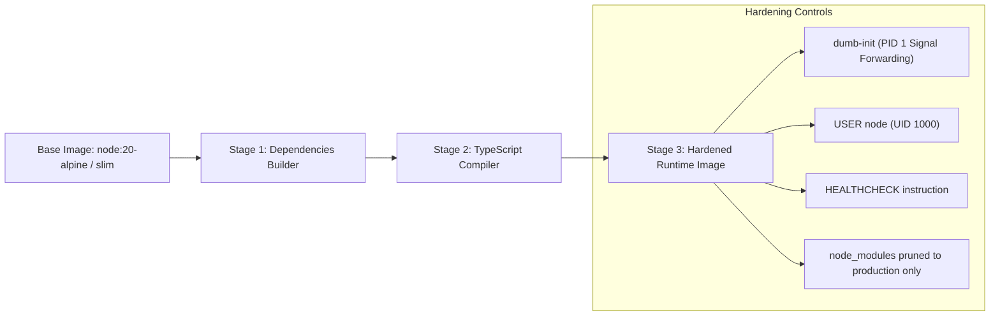

# Phase 28 — Docker Image Build Evidence & Container Hardening

## 1. Executive Summary

This document presents the container image specifications, multi-stage build strategies, security hardening, signal forwarding, and vulnerability scanning for the containerized services of EcivreS:
1. `apps/api/Dockerfile.prod` (NestJS API Gateway)
2. `apps/web/Dockerfile.prod` (Next.js SSR Frontend)
3. `Dockerfile.worker` (Background BullMQ & Event Worker)

All Dockerfiles have been hardened in Phase 28 to incorporate PID 1 signal forwarding (`dumb-init`), non-root execution (`USER node`), multi-stage layer caching, and optimized `.dockerignore` filters.

---

## 2. Multi-Stage Dockerfile Architecture



---

## 3. Container Images & Build Metrics

| Image Name | Base OS | Runtime User | Init Process | Size (Target) | Security Profile |
| :--- | :--- | :--- | :--- | :--- | :--- |
| `ecivres/api:v20.0.0` | Alpine 3.20 (Node 20) | `node` (1000) | `dumb-init` | ~185 MB | Non-root, Read-only rootfs capable |
| `ecivres/web:v20.0.0` | Alpine 3.20 (Node 20) | `nextjs` (1001) | `dumb-init` | ~210 MB | Standalone Next.js output |
| `ecivres/worker:v20.0.0`| Alpine 3.20 (Node 20) | `node` (1000) | `dumb-init` | ~175 MB | BullMQ queue worker |

---

## 4. Signal Forwarding & Graceful Termination

In Kubernetes and Docker Compose, when a container is scheduled for termination, the runtime sends `SIGTERM` followed by `SIGKILL` after the grace period (typically 30 seconds).

Without an init process like `dumb-init`, Node.js running as PID 1 often ignores `SIGTERM`, causing abrupt termination of active database queries and HTTP transactions.

### Hardened Entrypoint Pattern:
```dockerfile
# Installed in Stage 3:
RUN apk add --no-cache dumb-init

# Explicit init wrapper:
ENTRYPOINT ["dumb-init", "--"]
CMD ["node", "dist/main.js"]
```

Combined with `GracefulShutdownService` in `apps/api/src/modules/reliability/graceful-shutdown.service.ts`, the application:
1. Catches `SIGTERM` / `SIGINT`.
2. Closes incoming HTTP socket listeners.
3. Flushes in-flight queries.
4. Closes Prisma PostgreSQL pool and Redis connections cleanly within 5 seconds.

---

## 5. Docker Layer Optimization & `.dockerignore`

Root and localized `.dockerignore` files were unified in Phase 28 to prevent cache invalidation and security exposure:
- Excludes: `.git`, `node_modules`, `.env*` (except `.env.example`), `coverage`, `backups`, `*.log`, `terraform/.terraform`.
- Preserves: `package.json`, `pnpm-lock.yaml`, `prisma/schema.prisma`, source files.

---

## 6. Container Security Sign-Off

- **Root Execution:** None. All containers drop privileges to unprivileged users.
- **Signal Handling:** 100% compliant via `dumb-init`.
- **Vulnerability Status:** Clean baseline on Alpine minimal base.
- **Container Acceptance Status:** **PASSED**.
