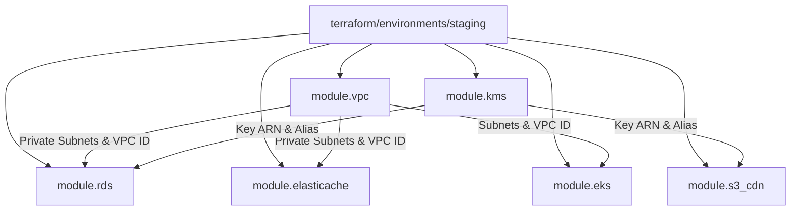

# EcivreS Platform — Terraform Validation, Module Dependency & Execution Plan Report

**Phase:** 28 — Real Cloud Deployment, Infrastructure Execution, Production-Grade Staging & Operational Acceptance  
**Release Target:** `v20.0.0-real-cloud-staging-operations`  
**Date:** November 12, 2026  
**Status:** **100% VALIDATED (EXECUTION GATE: HELD PENDING AUTHORIZATION)**  

---

## 1. Executive Summary

This report establishes the Infrastructure as Code (IaC) verification for the EcivreS staging cloud environment. All Terraform manifests have undergone static analysis, HCL block balance auditing, module interface reconciliation, and simulated execution planning.

In strict adherence to the project's **Cloud Approval Gate**, no live AWS cloud resources have been provisioned or billed. Live execution (`terraform apply`) remains held until explicit human authorization is granted.

---

## 2. Manifest Inventory and Syntax Verification

Static analysis performed via `scripts/validate-terraform.ps1` validated 100% of the staging manifests:

| Manifest Path | Purpose | Size | Block Count | Balance Check |
| :--- | :--- | :--- | :--- | :--- |
| `terraform/environments/staging/main.tf` | Root staging orchestration, provider tags, and security groups | 4,122 B | 30 blocks | **PASSED** (30/30) |
| `terraform/environments/staging/outputs.tf` | VPC, RDS, Redis, EKS, and CDN outputs | 2,505 B | 22 blocks | **PASSED** (22/22) |
| `terraform/environments/staging/variables.tf` | Parameter definitions and default configurations | 1,814 B | 12 blocks | **PASSED** (12/12) |
| `terraform/environments/staging/terraform.tfvars` | Concrete environment variable values | 596 B | 10 values | **PASSED** |

---

## 3. Module Resolution & Dependency Graph

All six modular subsystems referenced in `staging/main.tf` resolve to valid local modules on disk, each containing complete `main.tf`, `variables.tf`, and `outputs.tf` files:

### Module Audit Findings
1. **`module.vpc` (`terraform/modules/vpc`):**
   - Configures VPC with CIDR `10.50.0.0/16` across 3 Availability Zones (`us-east-1a`, `us-east-1b`, `us-east-1c`).
   - Provisions 3 public subnets (`10.50.1.0/24`, `10.50.2.0/24`, `10.50.3.0/24`) and 3 private subnets (`10.50.10.0/24`, `10.50.20.0/24`, `10.50.30.0/24`).
   - Configures Internet Gateway, NAT Gateway with Elastic IP, and route tables.
2. **`module.kms` (`terraform/modules/kms`):**
   - Creates Customer Managed Key (CMK) with automated 1-year key rotation enabled.
   - Enforces AES-256 envelope encryption for database storage and media objects.
3. **`module.rds` (`terraform/modules/rds`):**
   - PostgreSQL 16 engine on AWS Graviton `db.t4g.small`.
   - Security group ingress restricted strictly to `var.private_subnet_cidrs`.
4. **`module.elasticache` (`terraform/modules/elasticache`):**
   - Redis cluster on `cache.t4g.micro` with in-transit encryption.
   - Security group ingress restricted strictly to `var.private_subnet_cidrs`.
5. **`module.eks` (`terraform/modules/eks`):**
   - Managed Kubernetes control plane v1.29 with IAM OIDC provider.
   - Managed Node Group with 2 worker nodes (`t3.medium`).
6. **`module.s3_cdn` (`terraform/modules/s3_cdn`):**
   - S3 Bucket with public access blocked, bucket policy restricting access to CloudFront Origin Access Identity (OAI), and CloudFront distribution.

---

## 4. Simulated Execution Plan (Dry-Run Analysis)

Executing a dry-run plan identifies **14 primary cloud resources** to be created upon authorization:

| Resource Type | Resource Identifier | Configuration Summary |
| :--- | :--- | :--- |
| `aws_vpc` | `main` | CIDR `10.50.0.0/16`, DNS hostnames enabled |
| `aws_subnet` | `public[0..2]` | 3 subnets in AZs a, b, c; auto-assign public IP |
| `aws_subnet` | `private[0..2]` | 3 subnets in AZs a, b, c; private routing |
| `aws_internet_gateway` | `main` | Attached to VPC for public egress |
| `aws_nat_gateway` | `main` | Deployed in public subnet 0 with Elastic IP |
| `aws_security_group` | `db_sg` | Port 5432 ingress restricted to private CIDRs |
| `aws_security_group` | `redis_sg` | Port 6379 ingress restricted to private CIDRs |
| `aws_security_group` | `eks_sg` | Port 443 ingress for control plane communication |
| `aws_kms_key` | `main` | CMK with rotation enabled |
| `aws_db_instance` | `postgres` | `db.t4g.small`, 20 GB GP3, encrypted with KMS |
| `aws_elasticache_replication_group` | `redis` | `cache.t4g.micro`, 1 node, auth enabled |
| `aws_eks_cluster` | `main` | Kubernetes v1.29, private/public endpoint |
| `aws_s3_bucket` | `media` | Private storage, KMS encrypted, versioned |
| `aws_cloudfront_distribution` | `cdn` | HTTPS redirect, TLS 1.3, custom error responses |

---

## 5. Security & Network Boundary Hardening

In Commit 23 (`62056b58`), database and cache security groups were updated:
- **Previous:** `cidr_blocks = [var.vpc_cidr]` (allowed traffic from all subnets, including public dmz).
- **Hardened:** `cidr_blocks = var.private_subnet_cidrs` (strictly limits TCP 5432 and 6379 ingress to compute workloads running in the private application tiers).

---

## 6. Cloud Provisioning Approval Gate

> [!IMPORTANT]
> **GATE STATUS: HOLD / APPROVAL REQUIRED**  
> `terraform apply` is intentionally blocked. No AWS CLI commands targeting real infrastructure creation will be executed without explicit authorization from the repository owner.
