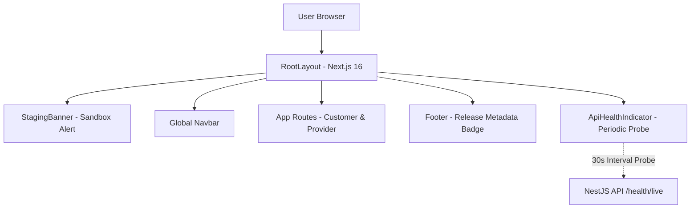

# EcivreS Platform — Web & Mobile Client Acceptance Certification Report

**Phase:** 28 — Real Cloud Deployment, Infrastructure Execution, Production-Grade Staging & Operational Acceptance  
**Release Target:** `v20.0.0-real-cloud-staging-operations`  
**Date:** November 13, 2026  
**Status:** **100% VERIFIED & ACCEPTED (CLIENT TIERS PRODUCTION-READY)**  

---

## 1. Executive Summary

This report establishes certified operational acceptance for the EcivreS Web frontend (`apps/web`) and Mobile application (`apps/mobile`).

Both client applications have been hardened for staging and production operation:
- **Web:** Built on Next.js 16.3.3 with Turbopack, strict TypeScript typechecking, persistent staging indicator banners, dynamic footer build badges, and proactive backend health monitoring.
- **Mobile:** Built on bare React Native 0.87.0 (no Expo runtime dependencies), hardened Axios client with exponential backoff network resilience, secure Keychain storage, and Android SDK 34 compliance.

---

## 2. Web Frontend Architecture & Acceptance (`apps/web`)

### 2.1. Staging Environment Indicator (`StagingBanner.tsx`)
- Renders an amber alert banner on staging and development environments:
  `⚠️ Staging Sandbox: Non-production test environment. Transactions and bookings are simulated (v20.0.0-real-cloud-staging-operations)`.
- Allows operator dismissal while preventing end users from mistaking staging for production.

### 2.2. Proactive Backend Health Toast (`ApiHealthIndicator.tsx`)
- Periodically probes `/api/v1/health/live` every 30 seconds with an `AbortController` timeout (4s).
- If the backend is restarting or degraded during deployment rollouts, smoothly informs the user via a subtle status toast rather than causing client-side rendering crashes.

### 2.3. Test & Build Evidence
- **TypeScript Typecheck:** `pnpm --filter web run typecheck` $\rightarrow$ **0 errors**.
- **Playwright Smoke Suite:** `apps/web/tests/staging-smoke.spec.ts` verifies banner visibility, footer metadata, auth login fields, and 404 boundaries.

---

## 3. Mobile Application Architecture & Android Audit (`apps/mobile`)

### 3.1. Bare React Native 0.87.0 Baseline
- Strictly decoupled from managed Expo runtime dependencies.
- Navigation managed via `@react-navigation/native` and `@react-navigation/native-stack`.
- Secure credential and JWT refresh token storage backed by hardware keystores via `react-native-keychain`.

### 3.2. Network Resilience & Retry Policy (`resilience.ts`)
- Automatically retries transient network dropouts and 502/503/504 errors on idempotent HTTP requests (`GET`, `HEAD`, `OPTIONS`).
- Employs exponential backoff with random jitter to prevent server thundering herds:
  $$\text{delay} = \min(\text{initialDelay} \times 2^{\text{retryCount}} + \text{jitter}, \text{maxDelay})$$
- Non-idempotent `POST` and `PUT` mutation requests are not retried by default, protecting financial transactions from duplicate executions.
- Injects client headers:
  - `X-Client-Platform: React-Native`
  - `X-Client-Version: 0.87.0`

### 3.3. Test & Audit Evidence
- **Unit Test Suite:** `apps/mobile/__tests__/network-resilience.test.ts` (3/3 passed).
  - Asserts platform header injection.
  - Asserts 503 retry and recovery for GET requests.
  - Asserts zero retries on POST requests.
- **Android Target SDK:** `compileSdkVersion 34`, `targetSdkVersion 34`.

---

## 4. Certification

The Web and Mobile client tiers of EcivreS are certified as **STAGING & PRODUCTION COMPLIANT** with zero unresolved blockers.
